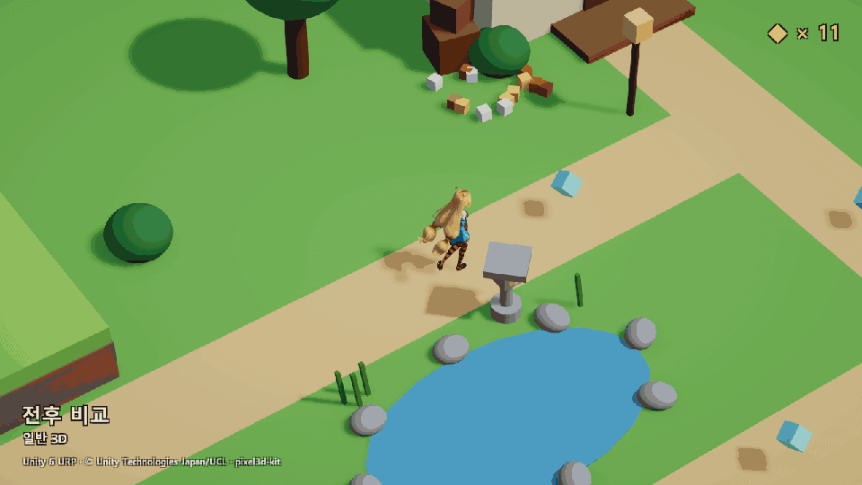
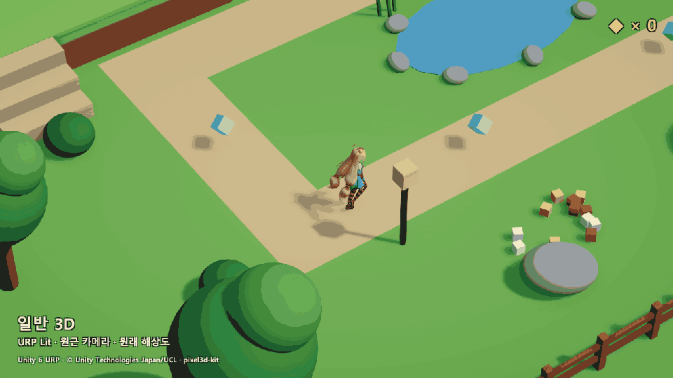
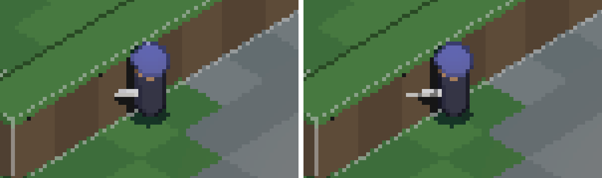
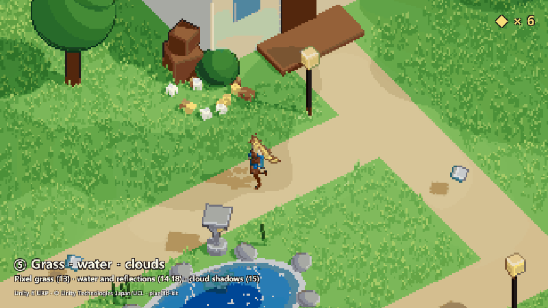
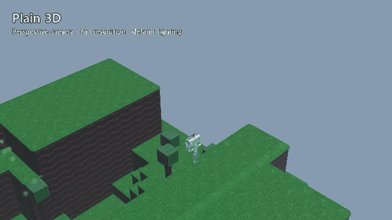
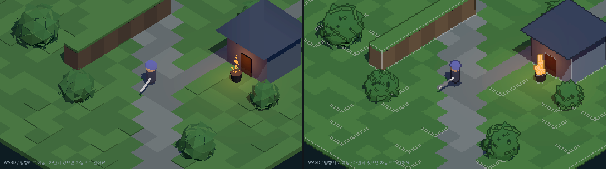

# pixel3d-kit

**Make real-time 3D look like hand-drawn pixel art.** A Claude Code plugin that teaches your agent the tricks behind "wait, that's 3D?" games and applies them to your project.

`Claude Code plugin` · `Three.js` · `Godot 4` · `Unity URP` · `MIT`

**English** · [한국어](#한국어)



*Plain 3D ↔ pixel3d, switching every second. Recorded in Unity 6 URP; the same techniques run in Three.js and Godot 4.*

> **Want all 27 techniques?** [pixel3d-kit Pro on Agensi](https://www.agensi.io/skills/pixel-3d-pro-make-3d-look-like-hand-drawn-pixel-art) adds 19 more (water, grass, night, smear, 2:1 iso and more), ready-to-use Unity and Godot shader files, and sprite-baking tools. [Compare free and Pro ↓](#free-vs-pro)

## Install in 30 seconds

Run these two commands in Claude Code:

```
/plugin marketplace add lattechicken999/pixel3d-kit
```

```
/plugin install pixel3d-kit@pixel3d-kit
```

Then open your project and say **"Make this game look like pixel art."** Claude picks the right recipe for your engine, applies the techniques, and checks each one with on/off screenshots.

## The 8 techniques

Lowering the resolution alone does not make pixel art; it makes blurry low-res 3D. These techniques work together.



*Plain 3D → ① low-res + orthographic → ② outlines and creases → ③ stepped light → ④ pixel snapping.*

| # | Technique | What it does |
|---|---|---|
| 1 | Low-res render, upscaled with no filtering | Pixels in the first place |
| 2 | **1-px outlines** (from depth edges) | Objects read as crisp sprites |
| 3 | **Lines on inner creases** (from normal edges) | Hand-drawn detail inside silhouettes |
| 4 | **Stepped shading** (fixed bands, optional palette) | No smooth 3D gradients |
| 5 | **Edited light response + separate shadow shapes** | Clean blocks of light instead of noisy facets |
| 6 | **Pixel-grid snapping + sub-pixel scrolling** (camera, objects, joints, particles) | Nothing shimmers, and the view still pans smoothly |
| 7 | **Stepped rotation** (8 directions) | Turns like flipping sprite frames |
| 8 | **Sprite-like depth sorting** | A sword against a wall is not cut off |



## Free vs Pro

| | Free (this repo) | [Pro](https://www.agensi.io/skills/pixel-3d-pro-make-3d-look-like-hand-drawn-pixel-art) |
|---|---|---|
| Techniques | 8 core | **27** (core + 19 more) |
| Three.js module and switchable demo | ✓ | ✓, with all 27 |
| Godot 4 and Unity URP recipes | Core techniques, code inside the docs | All techniques |
| Ready-to-use Unity URP shader files (outline, toon, grass, water) | – | ✓ |
| One-click Unity setup (**Tools › pixel3d › Install Outline Feature**) | – | ✓ |
| Godot shader files and a working example script | – | ✓ |
| Sprite tools: sprite sheets, lit depth sprites, sprite stacks | – | ✓ |
| Verified in real engines | Godot 1–6, Unity 1–4 and 6 | Also Unity 9–15, 17–19, 21–23 and 26 |
| Licence | MIT | Commercial, one per person, use in your own games and apps |

What Pro adds, recorded in Unity 6 URP:



| # | Technique | # | Technique |
|---|---|---|---|
| 9 | Hue-shifted light | 19 | Rim light / selective outline (sel-out) |
| 10 | Auto palette + world-locked dithering | 20 | Drifting fog banks |
| 11 | Dithered see-through walls | 21 | Night mode with glowing windows |
| 12 | Animation on twos (12 fps) | 22 | Hit flash + squash and stretch |
| 13 | Pixel grass with wind | 23 | Smear frames |
| 14 | Pixel water with foam | 24 | Depth sprites (lit, intersect 3D per pixel) |
| 15 | Cloud shadows | 25 | Bake at your game's pixel scale, tilts, palette lock |
| 16 | Sprite-sheet baker | 26 | 2:1 pixel isometric camera |
| 17 | Vision-circle reveal | 27 | Sprite-stack slice export |
| 18 | Pixel reflections in water | | |

**[→ Get pixel3d-kit Pro on Agensi](https://www.agensi.io/skills/pixel-3d-pro-make-3d-look-like-hand-drawn-pixel-art)** (one-time purchase). This free edition stays MIT.

## Tested in real engines, not just written

Every recipe here was run in Godot and Unity, recorded, and measured frame by frame; the GIFs on this page are cut straight from those recordings (rendered at 320×180, then upscaled). The runs found problems that only show up in a real engine, and the fixes are in the recipes.



*Godot 4.7.2, the official Platformer 3D demo (MIT). The Unity scene is built from Unity primitives, with Unity-chan (© Unity Technologies Japan/UCL).*

<details>
<summary>What the engine runs changed in the recipes</summary>

- **Snapping the camera is not enough.** On a diagonal pan the screen zig-zags in 4-pixel steps. Render a 1-pixel margin and shift the upscaled image by the remainder the snap threw away: **sub-pixel scrolling** is required.
- **Snap the character the camera follows in screen space.** Relative to the snapped camera it jumps a pixel up and down every frame, and the whole screen seems to shake.
- **Compute the pixel size from the real window size.** With Windows display scaling the window can open smaller than requested and the grid drifts. In Godot, also turn off physics interpolation on the camera.
- **Outlines and creases:** draw creases only on convex edges and brighten them by multiplying the colour; mixing toward white turns creases on dark surfaces into grey stripes. A 2-px outline is split 1 px inside and 1 px outside the silhouette, both in the near object's colour.
- **Unity toon shader:** `UsePass` pass names must be upper case, and the main light must not be multiplied by `distanceAttenuation`. Each one made the shadows or the sunlight vanish.
- **Pick the right scene.** A realistic first-person scene (the URP Garden sample) seen from above turned its fine textures into noise and never read as a game. Simple shapes and flat colours suit the look.

Details and measurements are in `skills/pixel-3d/references/{godot,unity,theory}.md`.

</details>

## Usage

| Do this | What happens |
|---|---|
| "Make this game look like pixel art" | The `pixel-3d` skill is used automatically |
| `/pixelize` | Applies the techniques to the current project. Pick the engine, pixel size and techniques, e.g. `/pixelize three 4 1-6,8` |
| `/pixel3d-new my-game forest cabin` | Starts a new pixel-art 3D project |
| Give a video file or link and say "learn this and apply it" | The `learn-from-video` skill extracts frames and the audio transcript, then applies what it found |

### Try the Three.js demo



From the repository folder, run the command below, then open <http://localhost:8000/examples/threejs-demo/>.

```bash
python3 -m http.server 8000
```

- Move: WASD or the arrow keys
- `?off=all` or `?off=2,8`: start with those techniques off
- `?t=1.3`: freeze time (for screenshots)
- `?pose=wall`: the sword-in-the-wall pose for technique 8

### Three.js API (summary)

```js
const pixel = new PixelRenderer(renderer, { pixelSize: 4 });     // 1, 2, 3, 6
const mat   = createToonMaterial({ color, steps: 3 });           // 4
sphericalizeNormals(geometry, 0.85); addShadowProxy(mesh, geo);  // 5
obj.userData.pixelSnap = true;                                   // 6
hero.rotation.y = quantizeAngle(facing, 8);                      // 7
const flat = flattenDepth(hero, { bias: 0.4 });                  // 8
pixel.render(scene, camera);
```

## Layout

```
.claude-plugin/          plugin.json, marketplace.json, icon
skills/pixel-3d/         SKILL.md, assets/threejs/pixel3d.js, references/{theory,godot,unity}.md
skills/learn-from-video/ SKILL.md, scripts/extract.sh  (ffmpeg, optional yt-dlp / Whisper)
commands/                /pixelize, /pixel3d-new
examples/threejs-demo/   Demo with every technique switchable
```

## Status

- **Three.js module:** rendered in headless Chromium (WebGL2); screenshots with each technique on and off were compared.
- **Godot recipe:** techniques 1–6 run and verified in Godot 4.7.2 (official Platformer 3D demo).
- **Unity recipe:** techniques 1–4 and 6 run and verified in Unity 6000.2 URP 17.2. Techniques 5, 7 and 8 are still ports of the same math. PRs welcome.

## Credits

- The techniques were collected after watching the Short "I thought it was a cute pixel game, but it's all 3D" by [Gamit | 1분 게임 이야기](https://www.youtube.com/@gamit_log), which introduces the *Never's End* team's GDC 2026 talk.
- This repository uses no art or assets from that video or game; only the techniques are implemented here.
- The outline and crease shaders follow the widely known community approach to 3D pixel-art rendering.

## License

MIT

---

# 한국어

[English](#pixel3d-kit) · **한국어**

**실시간 3D를 손으로 찍은 도트처럼.** "이게 3D였어?" 싶은 게임들의 기법을 에이전트에게 가르쳐, 내 프로젝트에 바로 적용하게 하는 Claude Code 플러그인입니다.

`Claude Code 플러그인` · `Three.js` · `Godot 4` · `Unity URP` · `MIT`


*일반 3D ↔ pixel3d를 1초마다 전환. Unity 6 URP에서 녹화했고, 같은 기법이 Three.js와 Godot 4에서도 동작합니다.*

> **기법 27가지 전부가 필요하다면?** [Agensi의 pixel3d-kit Pro](https://www.agensi.io/skills/pixel-3d-pro-make-3d-look-like-hand-drawn-pixel-art)는 기법 19가지(물, 풀, 밤, 잔상, 2:1 아이소 등), 바로 쓰는 Unity·Godot 셰이더 파일, 스프라이트 굽기 도구를 더했습니다. [무료판과 비교 ↓](#무료판-vs-pro)

## 30초 설치

Claude Code에서 아래 두 명령을 차례로 실행하세요.

```
/plugin marketplace add lattechicken999/pixel3d-kit
```

```
/plugin install pixel3d-kit@pixel3d-kit
```

그다음 프로젝트를 열고 **"이 게임 도트풍으로 바꿔줘"**라고 하면 됩니다. Claude가 엔진에 맞는 레시피를 골라 기법을 적용하고, 기법마다 켰을 때와 껐을 때의 스크린샷으로 결과를 확인합니다.

## 기법 8가지

해상도만 낮춰서는 도트 느낌이 나지 않고, 흐릿한 저해상도 3D가 될 뿐입니다. 아래 기법을 함께 써야 합니다.


*일반 3D → ① 저해상도·직교 카메라 → ② 외곽선·굴곡선 → ③ 단계 조명 → ④ 픽셀 스냅*

| # | 기법 | 효과 |
|---|---|---|
| 1 | 저해상도 렌더 + 확대 시 보간 없음 | 픽셀이 생깁니다 |
| 2 | **1픽셀 외곽선** (깊이 차이로 검출) | 물체가 스프라이트처럼 또렷해집니다 |
| 3 | **안쪽 굴곡에도 선** (노멀 차이로 검출) | 손으로 그린 듯한 디테일이 생깁니다 |
| 4 | **계단식 명암** (정해 둔 색 단계, 팔레트) | 3D 특유의 부드러운 그라데이션이 사라집니다 |
| 5 | **빛 받는 방향 편집 + 그림자용 모양 따로** | 울퉁불퉁한 면 대신 깔끔한 덩어리 명암이 나옵니다 |
| 6 | **픽셀 격자 정렬 + 서브픽셀 스크롤** (카메라, 오브젝트, 관절, 파티클) | 움직일 때 픽셀이 떨리지 않고 화면은 부드럽게 흐릅니다 |
| 7 | **각도를 띄엄띄엄** (8방향 회전) | 도트 그림 여러 장을 넘기는 것처럼 보입니다 |
| 8 | **겹치는 순서를 스프라이트처럼** | 벽에 붙어 서도 칼이 잘리지 않습니다 |


## 무료판 vs Pro

| | 무료판 (이 저장소) | [Pro](https://www.agensi.io/skills/pixel-3d-pro-make-3d-look-like-hand-drawn-pixel-art) |
|---|---|---|
| 기법 | 기본 8가지 | **27가지** (기본 + 19가지) |
| Three.js 모듈과 켜고 끄는 데모 | ✓ | ✓, 27가지 전부 |
| Godot 4·Unity URP 레시피 | 기본 기법, 코드는 문서 안에 | 모든 기법 |
| 바로 쓰는 Unity URP 셰이더 파일 (외곽선, 툰, 풀, 물) | – | ✓ |
| Unity 원클릭 설정 (**Tools › pixel3d › Install Outline Feature**) | – | ✓ |
| Godot 셰이더 파일과 동작하는 예제 스크립트 | – | ✓ |
| 스프라이트 도구: 스프라이트 시트, 빛 받는 깊이 스프라이트, 스프라이트 스택 | – | ✓ |
| 실제 엔진에서 검증 | Godot 1~6, Unity 1~4·6 | Unity 9~15, 17~19, 21~23, 26도 |
| 라이선스 | MIT | 상업용, 1인 1라이선스, 자기 게임·앱에 사용 |

Pro에서 추가되는 기법 (Unity 6 URP에서 녹화):


| # | 기법 | # | 기법 |
|---|---|---|---|
| 9 | 색조 이동 명암 | 19 | 림 라이트 (sel-out) |
| 10 | 자동 팔레트 + 월드 고정 디더링 | 20 | 흐르는 안개 |
| 11 | 가리는 물체 도트 투명화 | 21 | 밤 + 창문 불빛 |
| 12 | 애니메이션 12fps (on twos) | 22 | 타격 번쩍임 + 찌그러짐 |
| 13 | 도트 풀 + 바람 | 23 | 스미어(잔상) 프레임 |
| 14 | 도트 물 + 거품 | 24 | 깊이 스프라이트 (빛 받고 3D와 픽셀 단위로 겹침) |
| 15 | 구름 그림자 | 25 | 게임 픽셀 크기로 굽기, 기울기, 팔레트 고정 |
| 16 | 스프라이트 시트 굽기 | 26 | 2:1 도트 아이소 카메라 |
| 17 | 시야 원형 드러내기 | 27 | 스프라이트 스택 단면 굽기 |
| 18 | 물 반사 | | |

**[→ Agensi에서 pixel3d-kit Pro 구매하기](https://www.agensi.io/skills/pixel-3d-pro-make-3d-look-like-hand-drawn-pixel-art)** (한 번 구매). 이 무료판은 계속 MIT입니다.

## 문서로만이 아니라 실제 엔진에서 확인

모든 레시피를 Godot과 Unity에서 직접 실행하고, 녹화한 영상을 프레임 단위로 측정했습니다. 이 페이지의 GIF는 그 녹화에서 바로 뽑았습니다(320×180으로 그린 뒤 확대). 실제 엔진에서만 드러나는 문제들을 찾아 레시피에 고쳐 넣었습니다.


*Godot 4.7.2, 공식 Platformer 3D 데모(MIT). Unity 장면은 Unity 기본 도형으로 만들었고, 캐릭터는 유니티짱입니다(© Unity Technologies Japan/UCL).*

<details>
<summary>엔진에서 실행하며 레시피를 고친 내용</summary>

- **카메라 스냅만으로는 화면이 흔들립니다.** 대각선으로 움직이면 화면이 4픽셀 단위 지그재그로 튑니다. 저해상도 화면을 1픽셀 여유 있게 그리고, 스냅하며 버린 거리만큼 확대된 화면을 밀어 주는 **서브픽셀 스크롤**이 필수입니다.
- **카메라가 따라가는 캐릭터는 화면 기준으로 스냅해야 합니다.** 스냅된 카메라 기준으로 맞추면 매 프레임 1픽셀씩 위아래로 튀어 화면 전체가 떨려 보입니다.
- **스냅 간격은 실제 화면 크기에서 계산합니다.** Windows 화면 배율 때문에 창이 요청보다 작게 열리면 격자가 어긋납니다. Godot은 카메라의 물리 보간도 꺼야 합니다.
- **외곽선·굴곡선:** 굴곡선은 볼록한 모서리에만 그리고, 밝힐 때는 원래 색에 곱합니다. 흰색과 섞으면 어두운 면에서 회색 줄이 됩니다. 2픽셀 외곽선은 실루엣 안팎으로 1픽셀씩 나누고, 두 픽셀 모두 앞 물체의 색으로 칠합니다.
- **Unity 툰 셰이더:** `UsePass` 패스 이름은 대문자여야 하고, 메인 라이트에는 `distanceAttenuation`을 곱하지 않습니다. 둘 다 그림자나 직사광이 통째로 사라지는 원인이었습니다.
- **장면 선택:** 1인칭용 사실풍 장면(URP 샘플 Garden)은 내려다보면 잔무늬가 노이즈가 되어 게임 화면으로 보이지 않았습니다. 단순한 형태와 단색 위주의 장면이 맞습니다.

자세한 내용과 측정값은 `skills/pixel-3d/references/{godot,unity,theory}.md`에 있습니다.

</details>

## 사용법

| 이렇게 하면 | 일어나는 일 |
|---|---|
| "이 게임 도트풍으로 바꿔줘" | `pixel-3d` 스킬이 자동으로 쓰입니다 |
| `/pixelize` | 지금 프로젝트에 기법을 적용합니다. `/pixelize three 4 1-6,8`처럼 엔진, 픽셀 크기, 적용할 기법을 지정할 수 있습니다 |
| `/pixel3d-new my-game 숲속 오두막` | 도트풍 3D 프로젝트를 새로 만듭니다 |
| 영상 파일이나 링크를 주고 "이거 학습해서 적용해줘" | `learn-from-video` 스킬이 프레임과 음성 대본을 뽑아 정리한 뒤 적용합니다 |

### Three.js 데모 실행


저장소 폴더에서 아래 명령을 실행한 뒤 브라우저로 <http://localhost:8000/examples/threejs-demo/> 를 여세요.

```bash
python3 -m http.server 8000
```

- 이동: WASD 또는 방향키
- `?off=all` 또는 `?off=2,8`: 해당 기법을 끈 상태로 시작합니다
- `?t=1.3`: 시간을 멈춥니다 (스크린샷용)
- `?pose=wall`: 칼이 벽에 박힌 자세로 기법 8을 시험합니다

### Three.js API (요약)

```js
const pixel = new PixelRenderer(renderer, { pixelSize: 4 });     // 1, 2, 3, 6
const mat   = createToonMaterial({ color, steps: 3 });           // 4
sphericalizeNormals(geometry, 0.85); addShadowProxy(mesh, geo);  // 5
obj.userData.pixelSnap = true;                                   // 6
hero.rotation.y = quantizeAngle(facing, 8);                      // 7
const flat = flattenDepth(hero, { bias: 0.4 });                  // 8
pixel.render(scene, camera);
```

## 구성

```
.claude-plugin/          plugin.json, marketplace.json, icon
skills/pixel-3d/         SKILL.md, assets/threejs/pixel3d.js, references/{theory,godot,unity}.md
skills/learn-from-video/ SKILL.md, scripts/extract.sh  (ffmpeg, optional yt-dlp / Whisper)
commands/                /pixelize, /pixel3d-new
examples/threejs-demo/   기법마다 켜고 끌 수 있는 데모
```

## 상태

- **Three.js 모듈:** headless Chromium(WebGL2)에서 렌더링하고, 기법을 켰을 때와 껐을 때의 스크린샷을 비교해 확인했습니다.
- **Godot 레시피:** Godot 4.7.2에서 기법 1~6을 실행해 검증했습니다(공식 Platformer 3D 데모).
- **Unity 레시피:** Unity 6000.2 URP 17.2에서 기법 1~4와 6을 실행해 검증했습니다. 기법 5, 7, 8은 아직 같은 수식으로 옮긴 코드입니다. PR 환영합니다.

## 출처

- 기법은 [Gamit | 1분 게임 이야기](https://www.youtube.com/@gamit_log)의 쇼츠 「귀여운 도트 게임인줄 알았는데, 사실 전부 3D입니다」를 보고 정리했습니다. 이 쇼츠는 *Never's End* 개발진의 GDC 2026 발표를 소개합니다.
- 이 저장소는 그 영상과 게임의 아트나 에셋을 쓰지 않습니다. 기법만 직접 구현했습니다.
- 외곽선과 굴곡선 셰이더는 커뮤니티에 널리 알려진 3D 픽셀아트 렌더링 방식을 따릅니다.

## 라이선스

MIT
